# 🛒 NovaCart — Enterprise E-Commerce Platform

A production-grade, full-stack e-commerce platform built with **Spring Boot 4 (Java 17)** and **React 18 + TypeScript**, engineered for transactional concurrency, financial integrity, real-time WebSocket updates, bilingual RTL/LTR support, and full Docker containerization.

<p align="center">
  <a href="https://ecommerceapp-production-4a9c.up.railway.app">
    
  </a>
  <a href="https://ecommerceapp-production-5c76.up.railway.app/swagger-ui.html">
    
  </a>
  
  <a href="https://github.com/ahmedshawky7/ecommerce_app">
    
  </a>
</p>

---

## 📑 Table of Contents

- [Key Features](#-key-features)
- [Engineering & Security Highlights](#-engineering--security-highlights)
- [System Architecture](#️-system-architecture)
- [Tech Stack](#️-tech-stack)
- [Screenshots](#-screenshots)
- [Quick Start (Docker Compose)](#-quick-start-docker-compose)
- [Local Development Setup](#-local-development-setup)
- [Seeded Demo Credentials & Data](#-seeded-demo-credentials--data)
- [Running Automated Tests](#-running-automated-tests)
- [Stripe Webhook Testing](#-stripe-webhook-testing)
- [API Endpoints Overview](#-api-endpoints-overview)
- [Environment Variables](#-environment-variables)
- [Project Structure](#-project-structure)
- [Author & License](#-author--license)

---

## ✨ Key Features

### 🛍️ Customer Storefront
- **Bilingual i18n (`AR / EN`) & Auto `RTL / LTR`:** Seamless switching between Arabic (`Cairo` font, `dir="rtl"`) and English (`Plus Jakarta Sans` font, `dir="ltr"`) with bidirectional isolation (`dir="auto"` / `dir="ltr"`) for SKUs, emails, and prices, plus consistent Western numerals (`0-9`) everywhere.
- **Unified Light & Dark Modes:** Built with semantic CSS design tokens (`--bg-canvas`, `--bg-surface`, `--text-primary`, `--accent`, etc.) for balanced contrast in both light and charcoal-slate dark themes, persisted in `localStorage`.
- **Full-Width Responsive UI:** Fluid layout with a mobile navigation drawer (`320px`+) scaling smoothly to `1920px+` ultra-wide screens.
- **Smart Indicative Display Currency Switcher:** Switch display currency between `USD ($)`, `EGP (ج.م)`, `SAR (ر.س)`, and `AED (د.إ)` while strictly isolating **Base & Payment Currency (`USD`)** at checkout so display conversion never alters actual Stripe charges.
- **Catalog Search & Multi-Faceted Filtering:** Debounced keyword search, category pills, USD price range, minimum rating, in-stock filter, and sorting backed by JPA Specifications and Redis caching.
- **Product Variants & Lightbox Gallery:** Multi-variant support (SKU, size, color, independent price & stock), multi-image gallery with click-to-enlarge Lightbox modal.
- **Cart, Saved Addresses & Coupons:** Variant-aware cart, default/multiple shipping addresses, percentage & fixed-amount promo codes with min-order thresholds, max discount caps, free-shipping threshold, and tax breakdown.
- **Checkout & Stripe Integration:** Supports Stripe Checkout Sessions, PaymentIntents, Cash on Delivery, and 100%-discount free orders.
- **Verified-Buyer Reviews:** Only customers with a `DELIVERED` order for a product can submit a review, automatically recalculating product ratings.
- **Wishlist & Real-Time Order Tracking:** Live STOMP WebSocket notifications and a visual 5-step fulfillment timeline (`PENDING → CONFIRMED → PROCESSING → SHIPPED → DELIVERED`).

### 🔐 Enterprise Admin Console
- **KPI Overview & Analytics:** Real-time revenue, orders, customers, and product counts, 14-day daily revenue area chart, category revenue bar chart (`Recharts`), top-selling products, and prioritized low-stock alerts.
- **Product & Inventory Management:** Live search, category & stock-level filters (`All`, `Low Stock ≤ 10`, `Out of Stock`), `Active / Inactive` status indicators, confirmation dialogs before deletion, multi-variant editor, and direct **Cloudinary** image uploads.
- **Order Fulfillment State Machine:** Search and filter customer orders and advance valid transitions with automatic stock & coupon restoration upon cancellation.
- **Coupon & User Management:** Create/toggle promo codes and enable/disable user accounts (immediately revoking active refresh tokens).
- **Immutable Financial & System Audit Log:** Searchable trail of product price/stock changes, order updates, coupon edits, and user status toggles recording actor email, role, old/new values, and IP address.
- **Live Admin WebSocket Alerts:** Instant browser toast notifications for new orders, payment confirmations, cancellations, and low-stock events.

---

## 🛡️ Engineering & Security Highlights

- **Concurrency & Stock Locking:** Pessimistic row-level locking (`SELECT ... FOR UPDATE`) in deterministic ID order prevents race-condition overselling and deadlocks during simultaneous checkouts.
- **Idempotent Checkout (`Idempotency-Key`):** Prevents duplicate orders, double stock deductions, and double Stripe charges on network retries.
- **Stripe Webhook Signature & Replay Protection:** Verifies `Stripe-Signature` HMAC headers, validates payment amount & currency against the order total, and deduplicates processed events (`processed_webhook_events`).
- **JWT Rotation & Reuse Detection:** Short-lived access tokens (15m) + rotating refresh tokens (7d) with automatic session revocation on token reuse and immediate enforcement when a user is disabled.
- **Magic-Byte Image Validation:** `CloudinaryService` validates file size (≤ 5MB), MIME type, and actual JPEG/PNG/WebP binary signatures before uploading.
- **Automatic Cleanup Scheduler:** Scheduled background job cancels expired `PENDING` Stripe sessions and restores reserved stock & coupons, while purging expired idempotency and token records.

---

## 🏗️ System Architecture

```text
                       ┌──────────────────────────────────────┐
                       │     React 18 + TypeScript (Vite)     │
                       │  Tailwind Tokens • Query • STOMP WS  │
                       └──────────────────┬───────────────────┘
                                          │ HTTP / WebSocket
                                          ▼
                       ┌──────────────────────────────────────┐
                       │         Nginx Reverse Proxy          │
                       │  SPA Fallback • /api/* • /ws Upgrade │
                       └──────────────────┬───────────────────┘
                                          │
                                          ▼
                       ┌──────────────────────────────────────┐
                       │        Spring Boot 4 Backend         │
                       │  Spring Security (JWT + RBAC)        │
                       │  Pessimistic Locks • Idempotency     │
                       │  STOMP WebSockets • Audit Trail      │
                       └──┬──────────┬───────────┬─────────┬──┘
                          │          │           │         │
              ┌───────────▼──┐  ┌────▼─────┐  ┌──▼──────┐  └──► Stripe (Checkout & Webhooks)
              │   MySQL 8    │  │  Redis 7 │  │RabbitMQ │  └──► Cloudinary (Product Images)
              │ (ACID Store) │  │  (Cache) │  │ (Emails)│
              └──────────────┘  └──────────┘  └─────────┘
```

---

## 🛠️ Tech Stack

| Layer | Technologies |
|---|---|
| **Backend** | Java 17, Spring Boot 4.1.1, Spring Security, Spring Data JPA, Spring WebSocket (STOMP / SockJS), Bean Validation |
| **Database & Cache** | MySQL 8.0, Redis 7 |
| **Messaging & Jobs** | RabbitMQ (Asynchronous email notifications), Spring `@Scheduled` |
| **Payments & Media** | Stripe (`stripe-java` 24.9), Cloudinary (`cloudinary-http45`) |
| **Frontend** | React 18, TypeScript, Vite 6, Tailwind CSS 3.4, TanStack React Query, Axios, Recharts, `@stomp/stompjs`, Lucide React, React Hot Toast |
| **Testing** | JUnit 5, Mockito, MockMvc, H2 In-Memory DB (27 automated tests) |
| **DevOps & Proxy** | Multi-stage Dockerfiles, Nginx Reverse Proxy, Docker Compose with Healthchecks |
| **API Docs** | SpringDoc OpenAPI 3 / Swagger UI |

---

## 📸 Screenshots

### 🛒 Customer Storefront

| Storefront Catalog & Filters | Product Details, Variants & Zoom |
| :---: | :---: |
| 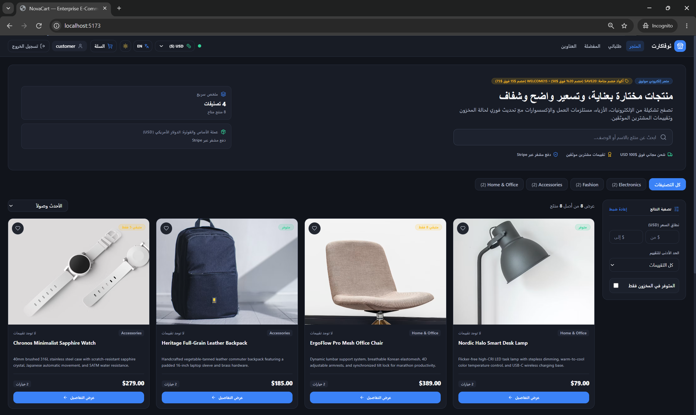 | 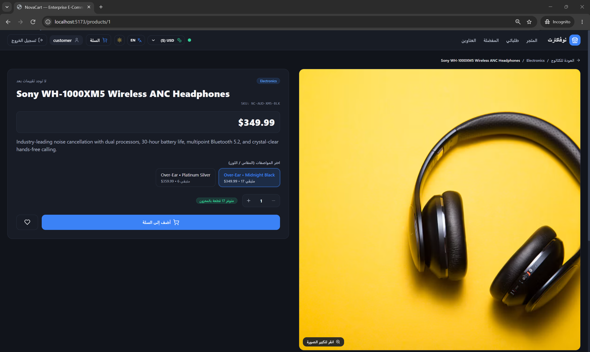 |

| Shopping Cart & Coupon Breakdown | Secure Checkout (USD Settlement Clarity) |
| :---: | :---: |
| 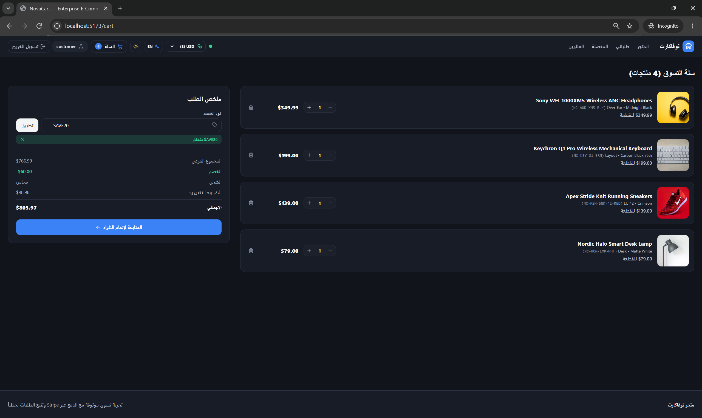 | 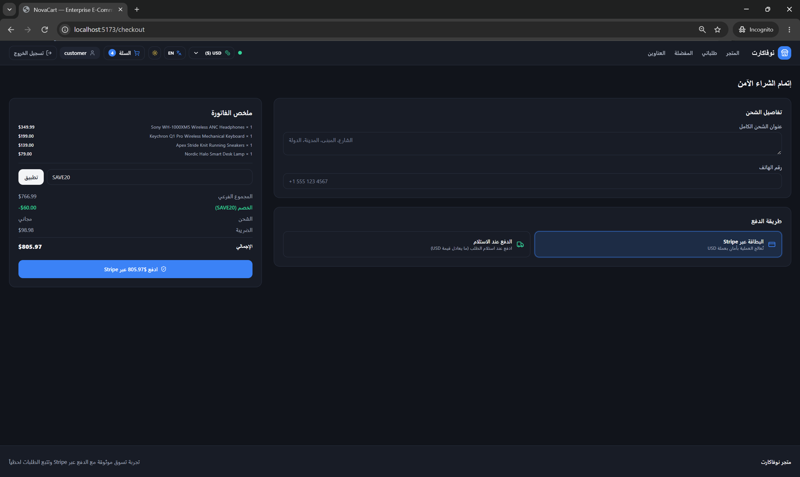 |

| Stripe Hosted Checkout | Order Confirmation |
| :---: | :---: |
| 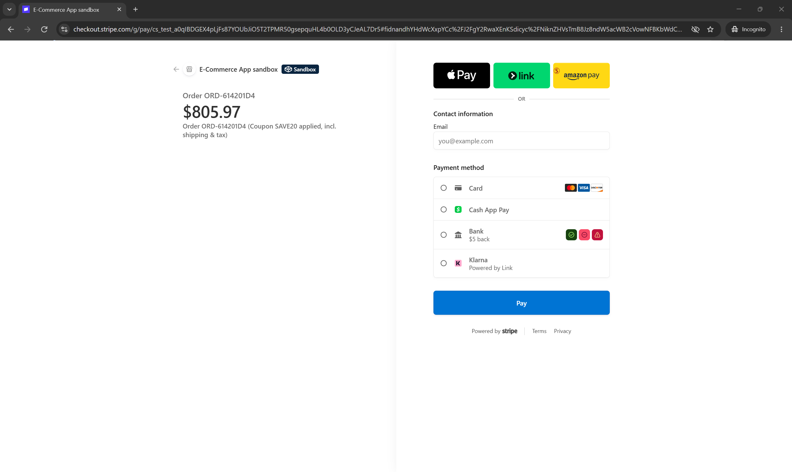 | 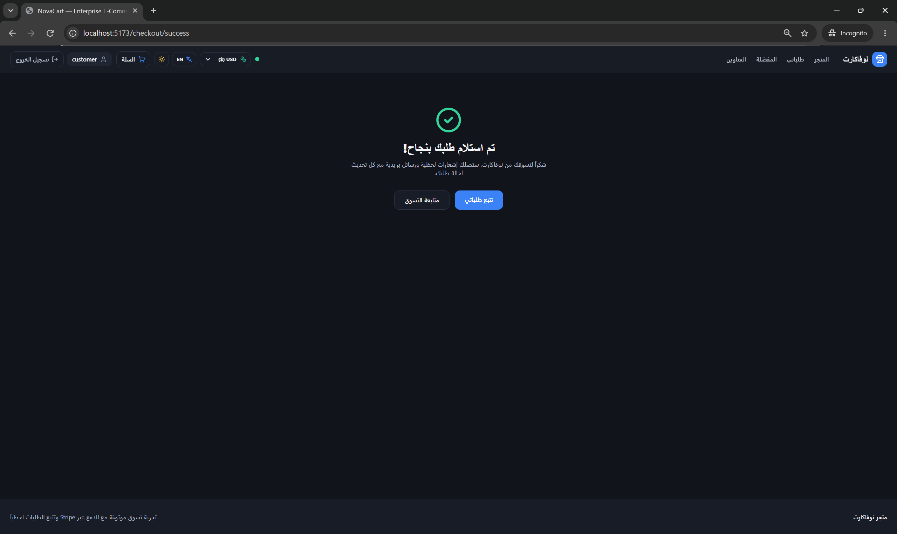 |

| Real-Time Order Tracking |
| :---: |
| 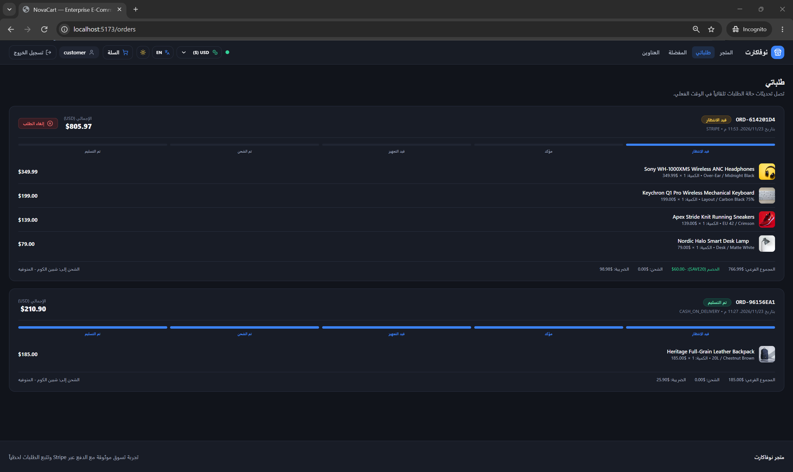 |

---

### 🔐 Admin Console

| Analytics Overview & Low Stock Alerts | Products & Inventory Management |
| :---: | :---: |
| 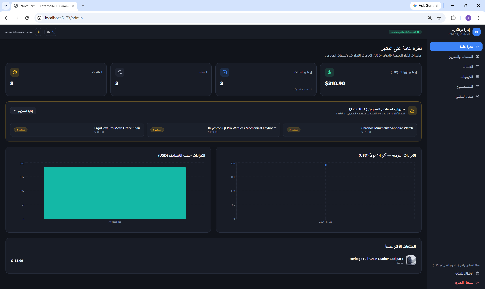 | 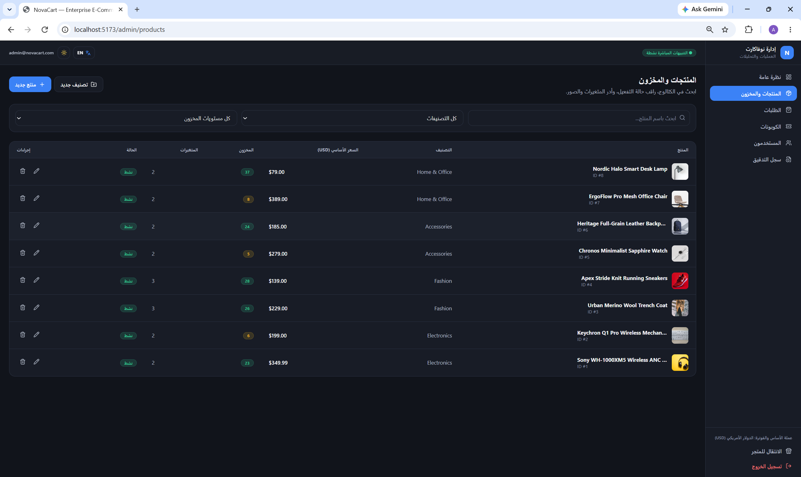 |

| Create/Edit Product & Cloudinary Gallery | Order Fulfillment Management |
| :---: | :---: |
| 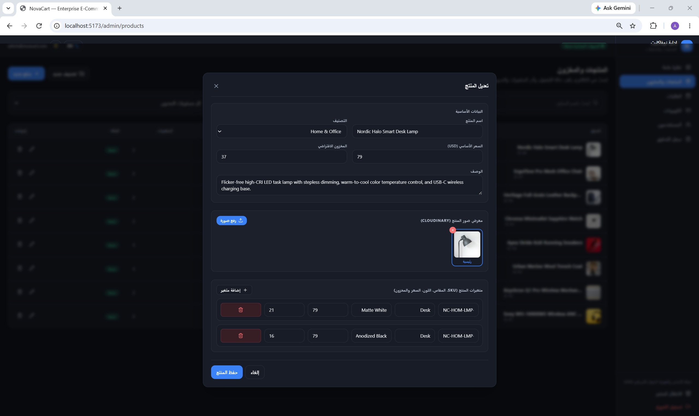 | 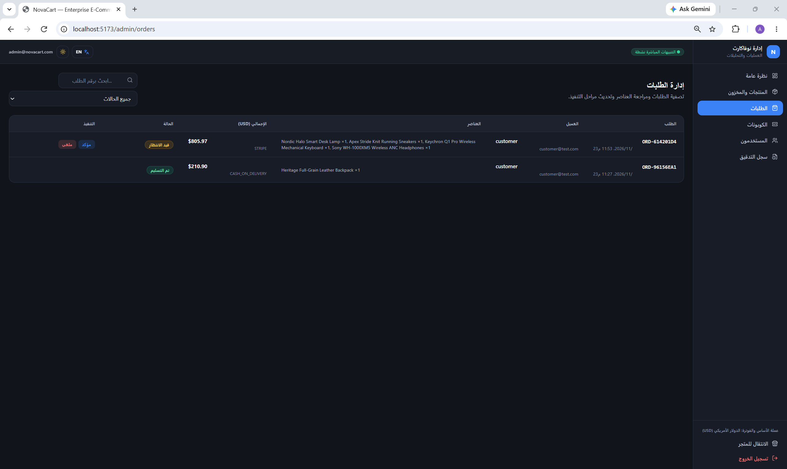 |

| Coupons & Promo Codes | Immutable Financial & System Audit Log |
| :---: | :---: |
| 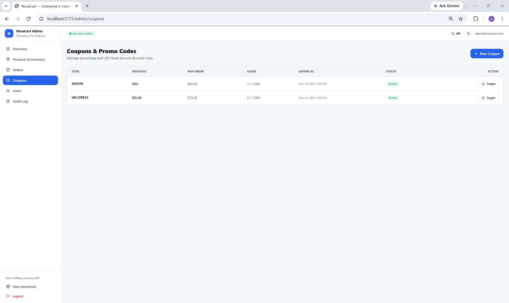 | 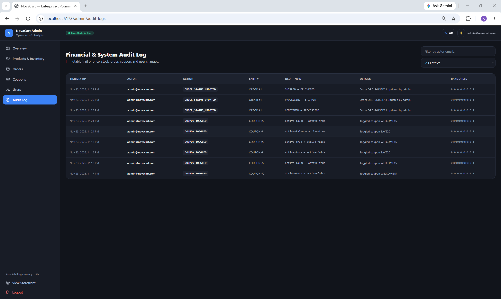 |

---

## 🚀 Quick Start (Docker Compose)

### Prerequisites
- Docker & Docker Compose v2+

### 1. Clone & Configure Environment
```bash
git clone https://github.com/ahmedshawky7/ecommerce_app.git
cd ecommerce_app
cp .env.example .env
```
Update `.env` with your `JWT_SECRET` and optional Stripe, Cloudinary, and SMTP credentials.

### 2. Build & Run the Complete Stack
```bash
docker compose up --build -d
docker compose ps
```
All 5 services (`mysql`, `redis`, `rabbitmq`, `backend`, `frontend`) include healthchecks and start in dependency order.

### 3. Access the Services
| Service | URL |
|---|---|
| **Storefront & Admin UI** | `http://localhost` |
| **Backend REST API** | `http://localhost:8080` |
| **Swagger UI** | `http://localhost/swagger-ui/index.html` |
| **RabbitMQ Management** | `http://localhost:15672` (`guest` / `guest`) |

---

## 💻 Local Development Setup

### 1. Start Infrastructure Containers
```bash
docker compose up -d mysql redis rabbitmq
```

### 2. Run the Spring Boot Backend
```bash
cd backend
./mvnw spring-boot:run
```
*(Windows PowerShell/CMD: `mvnw.cmd spring-boot:run`)*

### 3. Run the React Frontend
```bash
cd frontend
npm install
npm run dev
```
The Vite dev server runs at `http://localhost:5173`.

To verify the production frontend bundle:
```bash
cd frontend
npm run build
```

---

## 🌱 Seeded Demo Credentials & Data

On startup outside the `test` profile, `DataSeeder` (`CommandLineRunner`) automatically seeds the database if no products exist:

- **Default Admin Account:** `admin@novacart.com` / `Admin@123`
- **4 Categories:** `Electronics`, `Fashion`, `Accessories`, `Home & Office`
- **8 Products & Variants:** Multi-variant SKUs, sizes, colors, Unsplash imagery, and low-stock items (`≤ 10` units) to demonstrate inventory alerts.
- **2 Ready-to-Use Coupons:**
  - `SAVE20` — 20% off orders over `$50` (capped at `$60`)
  - `WELCOME15` — `$15` flat discount on orders over `$75`

---

## 🧪 Running Automated Tests

The backend includes **27 unit and integration tests** running against an isolated H2 in-memory database (`test` profile):

```bash
cd backend
./mvnw test
```

### Test Suite Coverage
- `OrderConcurrencyAndIdempotencyTest`: Multi-threaded race-condition test verifying pessimistic stock locking allows only one winner for the last unit in stock, `Idempotency-Key` deduplication, and stock/coupon/audit restoration on cancellation.
- `StripeWebhookIntegrationTest`: Signature verification, event replay deduplication, and stock restoration on `checkout.session.expired`.
- `SecurityAndAuthIntegrationTest`: RBAC enforcement (`403 Forbidden`), refresh token rotation & reuse detection (revoking all sessions on replay), and immediate rejection of disabled accounts.
- `ReviewAndCatalogIntegrationTest` & `ReviewServiceTest`: Verified-purchase review eligibility (`DELIVERED` orders only), rating recalculation, owner/admin authorization, and catalog filtering.
- `CouponAndAdminRbacIntegrationTest` & `PricingServiceTest`: Percentage/fixed discount caps, shipping thresholds, tax calculations, and admin authorization.
- `JwtServiceTest` & `CloudinaryServiceTest`: Token type separation (`ACCESS` vs `REFRESH`) and image MIME/magic-byte validation.

---

## 💳 Stripe Webhook Testing

To forward Stripe webhook events locally using the Stripe CLI:

```bash
stripe listen --events checkout.session.completed,checkout.session.expired,payment_intent.succeeded,payment_intent.payment_failed --forward-to localhost:8080/api/webhooks/stripe
```

Copy the generated `whsec_...` signing secret into `STRIPE_WEBHOOK_SECRET` in your `.env` file.

---

## 🌐 API Endpoints Overview

### Authentication (`/api/auth`)
- `POST /api/auth/register` — Register a new customer account
- `POST /api/auth/login` — Authenticate and receive JWT access + refresh tokens
- `POST /api/auth/refresh` — Rotate refresh token and issue a new token pair
- `POST /api/auth/logout` — Revoke the refresh token

### Catalog, Reviews & Wishlist
- `GET /api/products` | `GET /api/products/filter` | `GET /api/products/{id}`
- `POST /api/products` | `PUT /api/products/{id}` | `DELETE /api/products/{id}` *(Admin)*
- `GET /api/categories` | `POST /api/categories` *(Admin)*
- `GET /api/products/{productId}/reviews` | `GET /api/products/{productId}/reviews/eligibility`
- `POST /api/products/{productId}/reviews` | `PUT /api/reviews/{reviewId}` | `DELETE /api/reviews/{reviewId}`
- `GET /api/wishlist` | `GET /api/wishlist/ids` | `POST /api/wishlist/{productId}` | `DELETE /api/wishlist/{productId}`

### Cart, Addresses, Coupons & Orders
- `GET /api/cart` | `POST /api/cart/items` | `PUT /api/cart/items/{itemId}` | `DELETE /api/cart/items/{itemId}`
- `GET /api/addresses` | `POST /api/addresses` | `PUT /api/addresses/{id}` | `PUT /api/addresses/{id}/default` | `DELETE /api/addresses/{id}`
- `GET /api/coupons/pricing-preview` | `POST /api/coupons/validate`
- `POST /api/orders/checkout` | `POST /api/orders/create-checkout-session` *(Supports `Idempotency-Key` header)*
- `GET /api/orders` | `GET /api/orders/{id}` | `PUT /api/orders/{id}/cancel`
- `POST /api/webhooks/stripe` — Stripe webhook receiver

### Admin (`/api/admin`, `/api/orders/admin`, `/api/images`)
- `GET /api/admin/dashboard/stats` | `GET /api/admin/dashboard/top-products` | `GET /api/admin/inventory/low-stock`
- `GET /api/admin/analytics/sales` | `GET /api/admin/analytics/revenue-by-category`
- `GET /api/admin/orders` | `PUT /api/orders/admin/{id}/status`
- `GET /api/admin/coupons` | `POST /api/admin/coupons` | `PUT /api/admin/coupons/{id}` | `PUT /api/admin/coupons/{id}/toggle-status`
- `GET /api/admin/users` | `PUT /api/admin/users/{id}/toggle-status`
- `GET /api/admin/audit-logs`
- `POST /api/images/upload`

---

## 🔐 Environment Variables

| Variable | Description | Default / Example |
|---|---|---|
| `DB_NAME` | MySQL database name | `ecommerce_db` |
| `DB_ROOT_PASSWORD` | MySQL root password | `rootpassword` |
| `DB_USERNAME` | Backend DB username | `root` |
| `DB_PASSWORD` | Backend DB password | `rootpassword` |
| `JWT_SECRET` | Base64-encoded HMAC secret (min 256-bit) | *Required* |
| `CORS_ALLOWED_ORIGINS` | Comma-separated allowed CORS origins | `http://localhost,http://localhost:5173` |
| `PUBLIC_WS_URL` | WebSocket URL embedded in frontend build | `ws://localhost/ws` |
| `STRIPE_API_KEY` | Stripe Secret API Key (`sk_test_...`) | *Required for card payments* |
| `STRIPE_WEBHOOK_SECRET` | Stripe Webhook Secret (`whsec_...`) | *Required for webhooks* |
| `CLOUDINARY_CLOUD_NAME` | Cloudinary cloud name | *Required for uploads* |
| `CLOUDINARY_API_KEY` | Cloudinary API key | *Required for uploads* |
| `CLOUDINARY_API_SECRET` | Cloudinary API secret | *Required for uploads* |
| `MAIL_HOST` / `MAIL_PORT` | SMTP server host & port | `smtp.gmail.com` / `587` |
| `MAIL_USERNAME` / `MAIL_PASSWORD` | SMTP credentials | *Optional* |

---

## 📁 Project Structure

```text
ecommerce_app/
├── backend/
│   ├── Dockerfile
│   ├── pom.xml
│   └── src/
│       ├── main/java/com/example/ecommerce/
│       │   ├── config/          # Security, Redis, RabbitMQ, WebSocket, Swagger, Cloudinary, DataSeeder
│       │   ├── controller/      # REST & Stripe Webhook Controllers
│       │   ├── dto/             # Request/Response Records & PagedResponse
│       │   ├── entity/          # JPA Entities (Product, Variant, Order, Coupon, Review, AuditLog...)
│       │   ├── exception/       # GlobalExceptionHandler
│       │   ├── repository/      # Spring Data JPA + Specifications + Pessimistic Locks
│       │   ├── security/        # JwtService, JwtAuthenticationFilter, WebSocketAuthInterceptor
│       │   └── service/         # OrderService, PricingService, AuditService, RealtimeNotificationService
│       └── test/                # 27 Unit & Integration Tests (JUnit 5 + Mockito + MockMvc + H2)
├── frontend/
│   ├── Dockerfile
│   ├── nginx.conf
│   ├── package.json
│   └── src/
│       ├── components/          # Design System UI Primitives, ProductCard, Navbar, Layouts
│       ├── context/             # AuthContext, ThemeContext, I18nContext, CurrencyContext, WebSocketContext
│       ├── i18n/                # Complete EN & AR (RTL) translations
│       ├── lib/                 # Axios interceptors (silent token refresh), formatting & idempotency helpers
│       ├── pages/
│       │   ├── auth/            # Login & Register
│       │   ├── store/           # Shop, ProductDetail, Cart, Checkout, Orders, Addresses, Wishlist
│       │   └── admin/           # Overview, Products, Orders, Coupons, Users, AuditLogs
│       └── types/               # TypeScript API contracts
├── docs/
│   └── screenshots/             # 13 Storefront & Admin Console screenshots
├── docker-compose.yml           # Full 5-service production stack with healthchecks
├── .env.example                 # Environment variables template
└── README.md
```

---

## 👨‍💻 Author & License

**Ahmed Shawky**

- GitHub: [@ahmedshawky7](https://github.com/ahmedshawky7)
- Repository: [ecommerce_app](https://github.com/ahmedshawky7/ecommerce_app)
- Email: ahmedeltabakh703@gmail.com

This project is licensed under the **MIT License**. See the [`LICENSE`](LICENSE) file for details.
